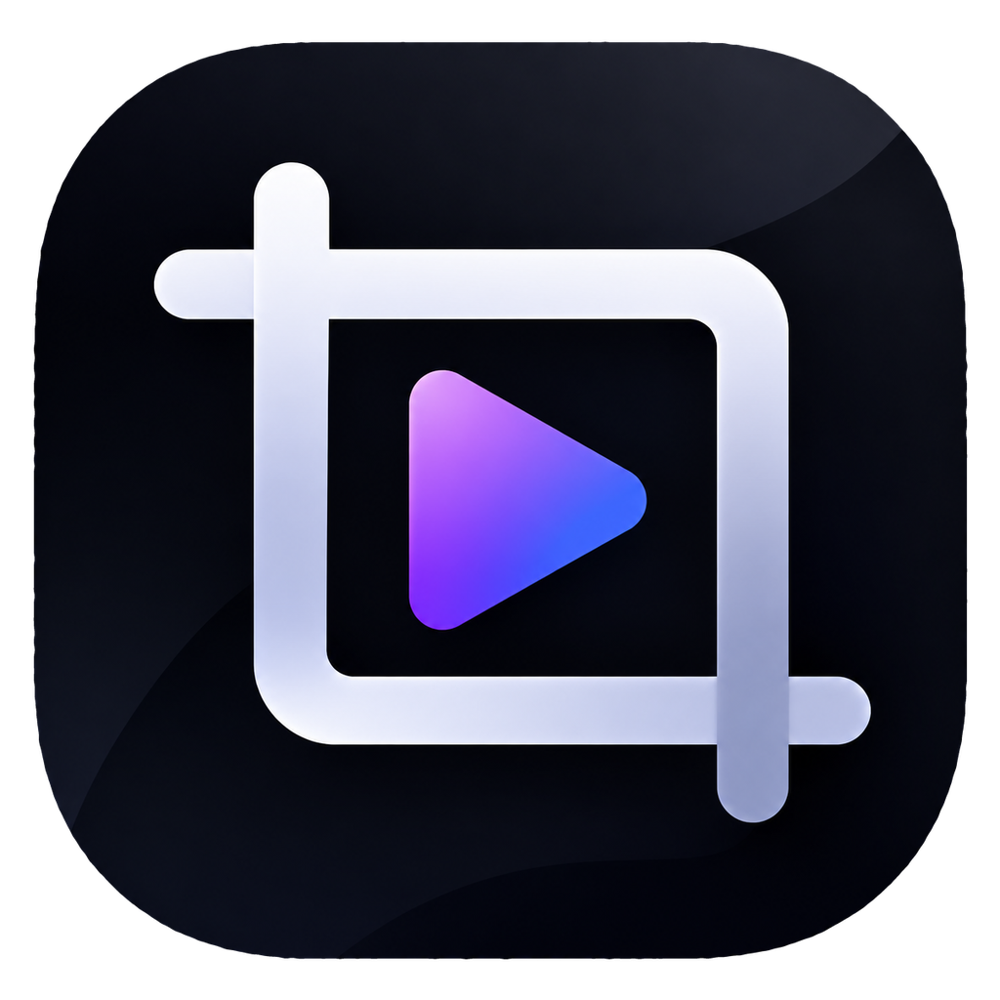
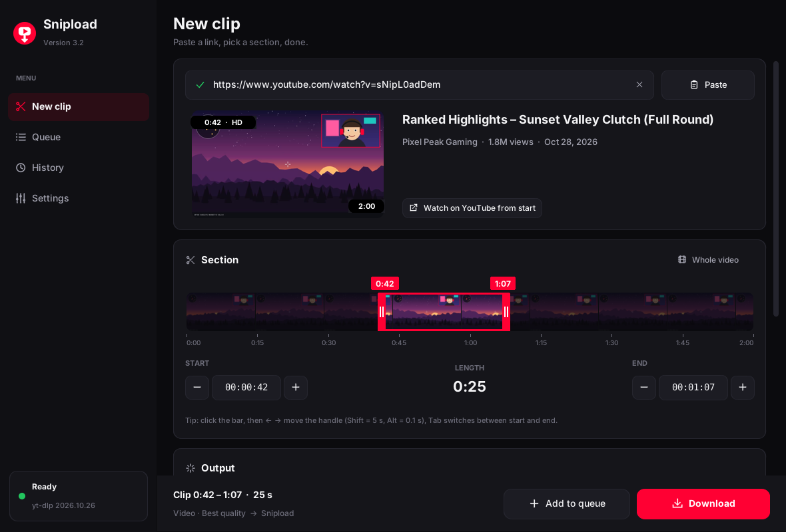
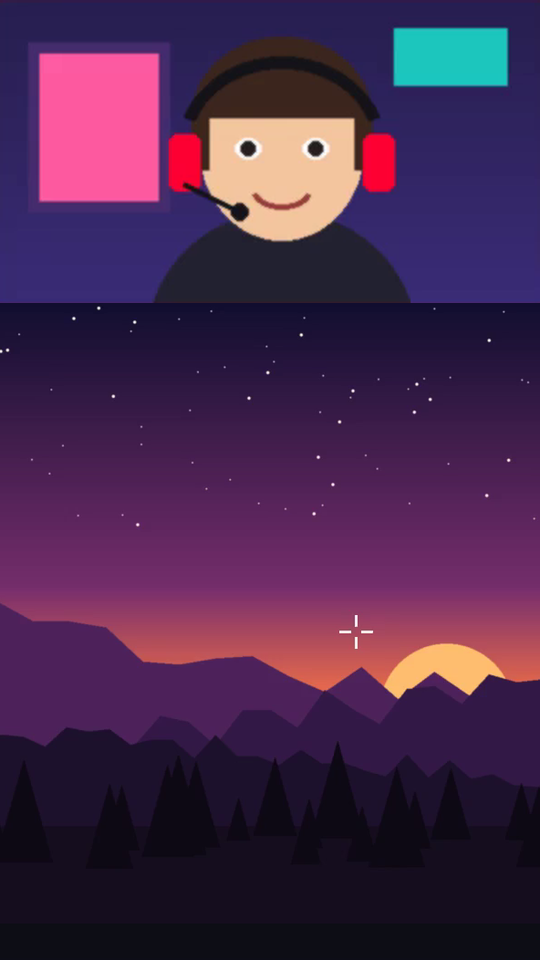
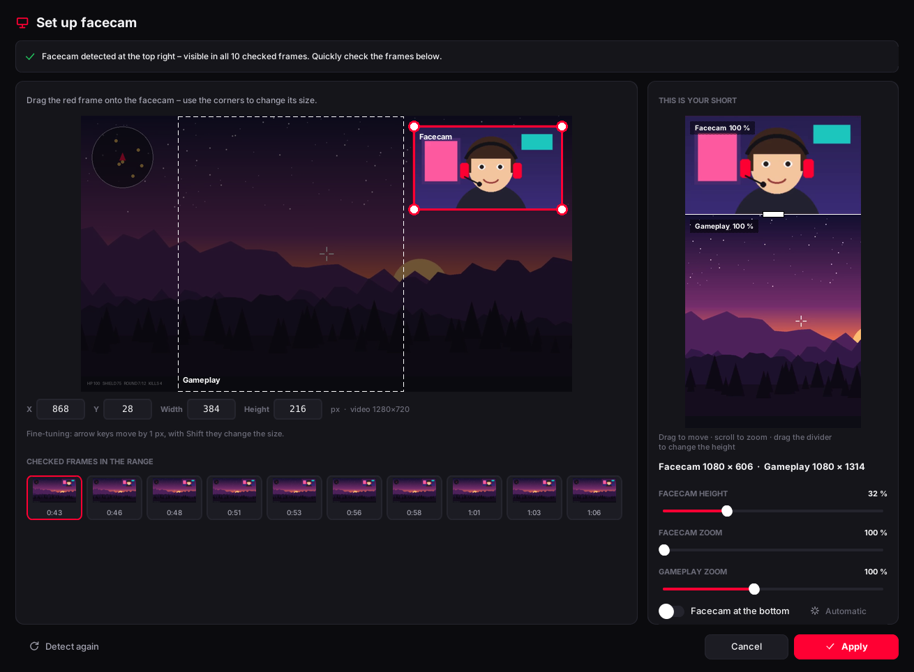

  

<h1 align="center">Snipload</h1>

  <b>Lädt nur den Teil eines YouTube-Videos herunter, den du wirklich brauchst.</b> 
  Start und Ende wählen – Snipload holt genau diesen Abschnitt, sekundengenau, und macht auf Wunsch gleich einen fertigen Short daraus.

  <a href="../../releases/latest"><b>⬇ Snipload.exe herunterladen</b></a> ·
  Windows 10 / 11 · kostenlos · ohne Installation ·
  <a href="README.md">English</a>

  

---

## Warum Snipload?

Einen ganzen 3-Stunden-Stream herunterzuladen, um drei Minuten davon zu behalten, dauert und kostet
Speicherplatz. Snipload fragt YouTube nur nach dem Abschnitt, den du auswählst, zum Beispiel von `0:42` bis
`1:07`, und schneidet ihn genau dort. Ohne Konto, ohne Werbung, ohne Browser-Erweiterung.

## Funktionen

### ✂️ Genau den Clip, den du willst
- **Link einfügen und los.** Kopierst du einen YouTube-Link, übernimmt Snipload ihn von selbst aus der Zwischenablage.
- **Filmstreifen-Zeitleiste** wie im Videoschnitt: Start- und End-Griff ziehen oder die Mitte ziehen, um den
  ganzen Abschnitt zu verschieben. Beim Darüberfahren siehst du das Bild genau an dieser Stelle, erst aus dem
  Storyboard und kurz danach als scharfes HD-Standbild.
- **Zeitfelder** mit −/+, Mausrad und Pfeiltasten (Umschalt = 5 s, Alt = 0,1 s).
- **Links mit Zeitangabe** (`&t=125`, `?t=1m30s`) setzen den Start automatisch.
- **Sekundengenaues Schneiden.** Ausgeschaltet lädt es noch schneller.

### 📱 Fertig für Shorts, TikTok und Reels
| Format | Ergebnis |
|---|---|
| **Original** | Das Video wie auf YouTube, bis 4K |
| **Shorts 9:16** | 1080×1920, aus der Bildmitte geschnitten |
| **Shorts + Blur** | 1080×1920, ganzes Bild in der Mitte mit unscharfem Hintergrund |
| **Facecam-Split** | 1080×1920 mit Facecam oben und Gameplay unten |
| **Nur Facecam** | Nur die Facecam als eigenes Video, 1:1 in Originalgröße |
| **Original + Facecam** | Ein Download, zwei Dateien: das normale Video und die Facecam |
| **Nur Ton** | MP3, M4A oder WAV |

### 🎥 Automatische Facecam-Erkennung (Streams und VODs, auch Twitch)

- Snipload prüft rund 10 Bilder über deinen Zeitraum, findet das Gesicht und **misst die Facecam dann
  pixelgenau in voller Auflösung**. Der Rahmen bleibt weg, und Standardgrößen wie 640×360 rasten ein.
- Es **prüft den ganzen Zeitraum** und warnt mit Zeitpunkt, falls die Facecam irgendwo fehlt.
- **Du behältst die Kontrolle.** Rahmen auf die Facecam ziehen, genaue Pixelwerte eintippen oder mit den
  Pfeiltasten um 1 px verschieben.
- **Facecam und Gameplay größer oder kleiner machen.** Trennlinie ziehen, mit dem Mausrad zoomen und mit
  der Maus verschieben, alles in einer Live-Vorschau im 9:16-Format. Snipload wählt die Größen automatisch
  so, dass die Facecam ohne Abschneiden passt.

 

### ⚡ Schnell und ohne Stress
- **Kodieren mit der Grafikkarte** (NVIDIA, Intel, AMD), wenn vorhanden, sonst mit einer schnellen CPU-Einstellung.
- **Warteschlange:** mehrere Clips sammeln, Snipload lädt sie nacheinander.
- **Verlauf** mit Vorschaubildern, Suche und „Nochmal“.
- **Läuft sofort:** Snipload lädt [yt-dlp](https://github.com/yt-dlp/yt-dlp) und [ffmpeg](https://ffmpeg.org)
  selbst herunter, ohne Adminrechte und ohne winget.
- **Bleibt funktionsfähig:** yt-dlp wird automatisch aktuell gehalten. Verweigert YouTube einen Download
  (HTTP 403), aktualisiert Snipload yt-dlp und versucht von selbst einen anderen Weg.
- **Aktualisiert sich selbst:** Neue Versionen laden im Hintergrund, danach startet Snipload neu und macht
  genau dort weiter, wo du warst.

### 🌍 10 Sprachen
English · Deutsch · 日本語 · Español · Français · Português · 한국어 · 简体中文 · Türkçe · Русский

Standard ist Englisch. Umstellen unter **Settings → Language** bzw. **Einstellungen → Sprache**.

## Loslegen

1. **[`Snipload.exe` herunterladen](../../releases/latest)** (unter *Assets*) und starten. Installieren musst du nichts.
2. Zeigt Windows *„Der Computer wurde durch Windows geschützt“*, auf **Weitere Informationen → Trotzdem
   ausführen** klicken. Das kommt bei neuen Programmen ohne Code-Signatur vor.
3. Beim ersten Mal bietet Snipload an, yt-dlp und ffmpeg herunterzuladen. **Installieren** klicken und etwa eine Minute warten.
4. YouTube-Link kopieren, Start und Ende ziehen, dann **Herunterladen** klicken. 🎬

**Tastenkürzel:** `Strg+V` Link einfügen · `Strg+Enter` herunterladen · `Strg+1…4` Seiten wechseln

## Häufige Fragen

<b>Der Download ist sehr langsam („0.1× Tempo“)</b>

Beim sekundengenauen Schneiden muss das Video neu kodiert werden. Auf älteren oder langsameren PCs kann das
bei 1440p oder 4K dauern. Snipload nutzt dafür die Grafikkarte, wenn es geht. Du kannst auch
**Einstellungen → Sekundengenau schneiden** ausschalten, das ist um ein Vielfaches schneller. Der Clip
beginnt dann aber eventuell ein, zwei Sekunden früher.

<b>„YouTube hat den Download verweigert (HTTP 403)“</b>

YouTube ändert ständig etwas, und ältere yt-dlp-Versionen funktionieren dann nicht mehr. Snipload
aktualisiert yt-dlp bereits automatisch und versucht es erneut. Kommt es trotzdem, ein paar Minuten warten und
noch einmal versuchen.

<b>Wo landen meine Dateien?</b>

Standardmäßig im Ordner **Downloads**. Ändern kannst du das unter Einstellungen → Speichern. Dateinamen folgen
einer Vorlage mit `{title}`, `{channel}`, `{start}`, `{end}`, `{date}` und `{id}`.

> Bitte nur Inhalte herunterladen, die du verwenden darfst.

Technische Details und Aufbau des Codes: siehe [README.md](README.md#for-developers).
