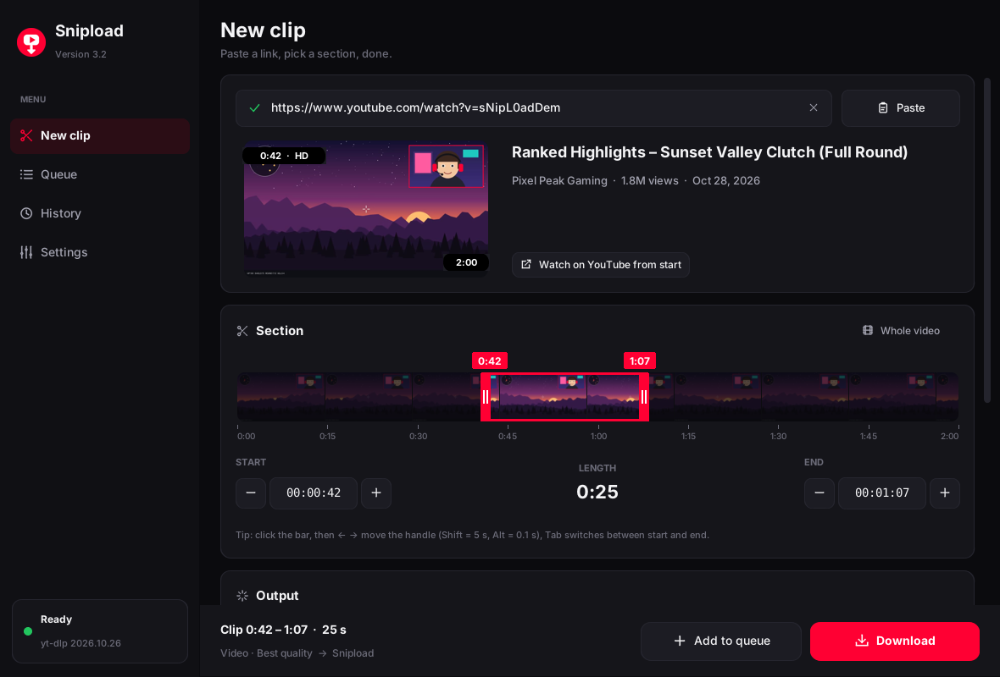
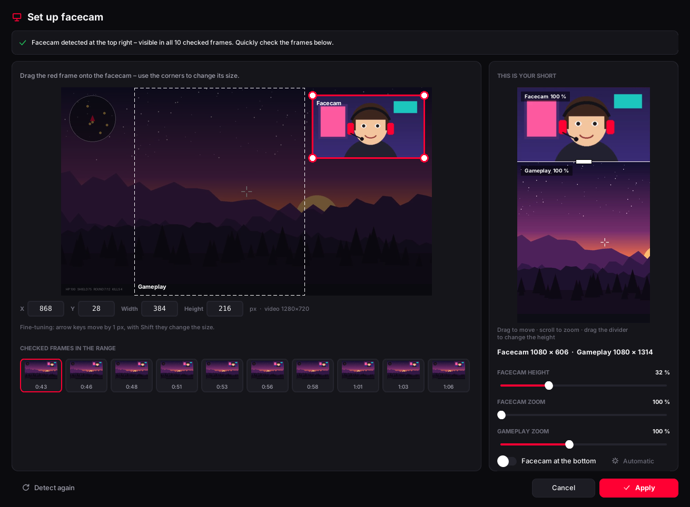
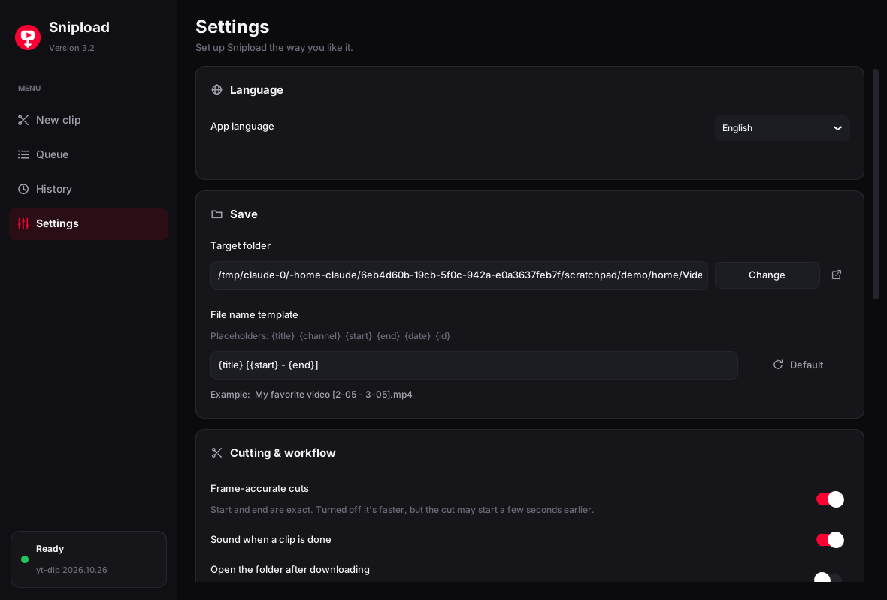

  

<h1 align="center">Snipload</h1>

  <b>Download just the part of a YouTube video you actually need.</b> 
  Pick a start and an end – Snipload grabs only that section, frame-accurate, and can turn it into a ready-to-post Short.

  <a href="../../releases/latest"><b>⬇ Download Snipload.exe</b></a> ·
  Windows 10 / 11 · free · no installation ·
  <a href="README.de.md">Deutsch</a>

  

---

## Why Snipload?

Downloading a whole 3-hour stream just to keep three minutes of it is slow and wastes space. Snipload asks
YouTube only for the section you choose – from `0:42` to `1:07`, for example – and cuts it exactly at those
points. No account, no ads, no browser extension.

## Features

### ✂️ Clip exactly what you want
- **Paste a link and it loads.** Copy a YouTube link and Snipload picks it up from the clipboard by itself.
- **Filmstrip timeline** like in a video editor: drag the start and end handles, or drag the middle to move
  the whole section. Hovering shows the frame at that exact spot, first from the storyboard and a moment
  later as a sharp HD still.
- **Precise time fields** with −/+, mouse wheel and arrow keys (Shift = 5 s, Alt = 0.1 s).
- **Links with a timestamp** (`&t=125`, `?t=1m30s`) set the start automatically.
- **Frame-accurate cuts.** You can turn them off for even faster downloads.

### 📱 Ready for Shorts, TikTok and Reels
| Format | What you get |
|---|---|
| **Original** | The video as on YouTube, up to 4K |
| **Shorts 9:16** | 1080×1920, cut from the center of the frame |
| **Shorts + blur** | 1080×1920, the whole frame in the middle with a blurred background |
| **Facecam split** | 1080×1920 with the facecam on top and the gameplay below |
| **Facecam only** | Just the facecam as its own video, 1:1 at original size |
| **Original + Facecam** | One download, two files: the normal video and the facecam |
| **Audio only** | MP3, M4A or WAV |

### 🎥 Automatic facecam detection (streams and VODs, Twitch too)

- Snipload checks about 10 frames across your range, finds the face and then **measures the facecam
  pixel-perfect at full resolution**. The border is left out, and standard sizes like 640×360 snap into place.
- It **checks the whole range** and warns you if the facecam disappears somewhere, with the timestamp.
- **You stay in control.** Drag the frame onto the facecam, type exact pixel values, or nudge it by 1 px
  with the arrow keys.
- **Make the facecam and the gameplay bigger or smaller.** Drag the divider, scroll to zoom and drag to
  move, all in a live 9:16 preview. Snipload sets sensible sizes automatically, so the facecam fits
  without being cropped.

 

### ⚡ Fast and hassle-free
- **Graphics card encoding** (NVIDIA, Intel, AMD) when available, otherwise a fast CPU preset.
- **Queue:** collect several clips and Snipload downloads them one after another.
- **History** with thumbnails, search and “Again”.
- **Works out of the box:** Snipload downloads [yt-dlp](https://github.com/yt-dlp/yt-dlp) and
  [ffmpeg](https://ffmpeg.org) by itself, without admin rights or winget.
- **Keeps itself working:** yt-dlp is kept up to date automatically. If YouTube refuses a download
  (HTTP 403), Snipload updates yt-dlp and tries another way on its own.
- **Updates itself:** new versions download in the background, and Snipload restarts and reopens right
  where you were.

### 🌍 10 languages
English · Deutsch · 日本語 · Español · Français · Português · 한국어 · 简体中文 · Türkçe · Русский

English is the default. Change the language under **Settings → Language**.

## Getting started

1. **[Download `Snipload.exe`](../../releases/latest)** (under *Assets*) and run it. There's nothing to install.
2. If Windows shows *“Windows protected your PC”*, click **More info → Run anyway**. This happens with
   new apps that aren't code-signed.
3. On first use, Snipload offers to download yt-dlp and ffmpeg. Click **Install** and wait about a minute.
4. Copy a YouTube link, drag the start and end, then click **Download**. 🎬

**Shortcuts:** `Ctrl+V` paste link · `Ctrl+Enter` download · `Ctrl+1…4` switch pages

## FAQ

<b>The download is very slow (“0.1× speed”)</b>

Frame-accurate cutting has to re-encode the video. On older or slower PCs this can be slow at 1440p or 4K.
Snipload uses your graphics card when it can. You can also turn off **Settings → Frame-accurate cuts**,
which makes it many times faster, though the clip may then start a second or two early.

<b>“YouTube refused the download (HTTP 403)”</b>

YouTube changes things often, and older yt-dlp versions stop working. Snipload already updates yt-dlp and
retries automatically. If it still happens, wait a few minutes and try again.

<b>Where are my files?</b>

By default in your **Downloads** folder. You can change it under Settings → Save. File names follow a
template with `{title}`, `{channel}`, `{start}`, `{end}`, `{date}` and `{id}`.

<b>Is it safe?</b>

The source code is right here. Every release is built automatically by GitHub Actions from this code (see
*Actions*). Snipload only talks to YouTube, GitHub (for updates and tools) and the official
ffmpeg build server.

> Please only download content you're allowed to use.

## For developers

Snipload is written in Python with [CustomTkinter](https://github.com/TomSchimansky/CustomTkinter),
uses OpenCV for face detection, and is packaged with PyInstaller.

| Path | Contents |
|---|---|
| `src/main.py` | Entry point (plus `--selftest` for CI) |
| `src/snipload/app.py` | Main window, sidebar, events, updates |
| `src/snipload/pages/` | Pages: New clip, Queue, History, Settings, Facecam editor |
| `src/snipload/jobs.py` | Downloads, queue, cutting and Shorts conversion (yt-dlp + ffmpeg) |
| `src/snipload/facecam.py` | Facecam detection, pixel-perfect measurement, 9:16 layout |
| `src/snipload/tools.py` | Finding/downloading yt-dlp and ffmpeg, video info, encoders |
| `src/snipload/updater.py` | Self-update via GitHub Releases |
| `src/snipload/i18n.py` · `locales/` | Translations (English source texts in `locales/_keys.py`) |
| `src/snipload/widgets.py` · `theme.py` · `icons.py` | UI building blocks, colors, fonts, icons |
| `.github/workflows/build.yml` | Builds the exe on Windows, runs self-tests, publishes the release |

The version number lives in `src/snipload/__init__.py`, and the build number is appended automatically.
To add a language, copy `locales/de.py`, translate the texts and register the code in `i18n.py` and
`locales/__init__.py`.
