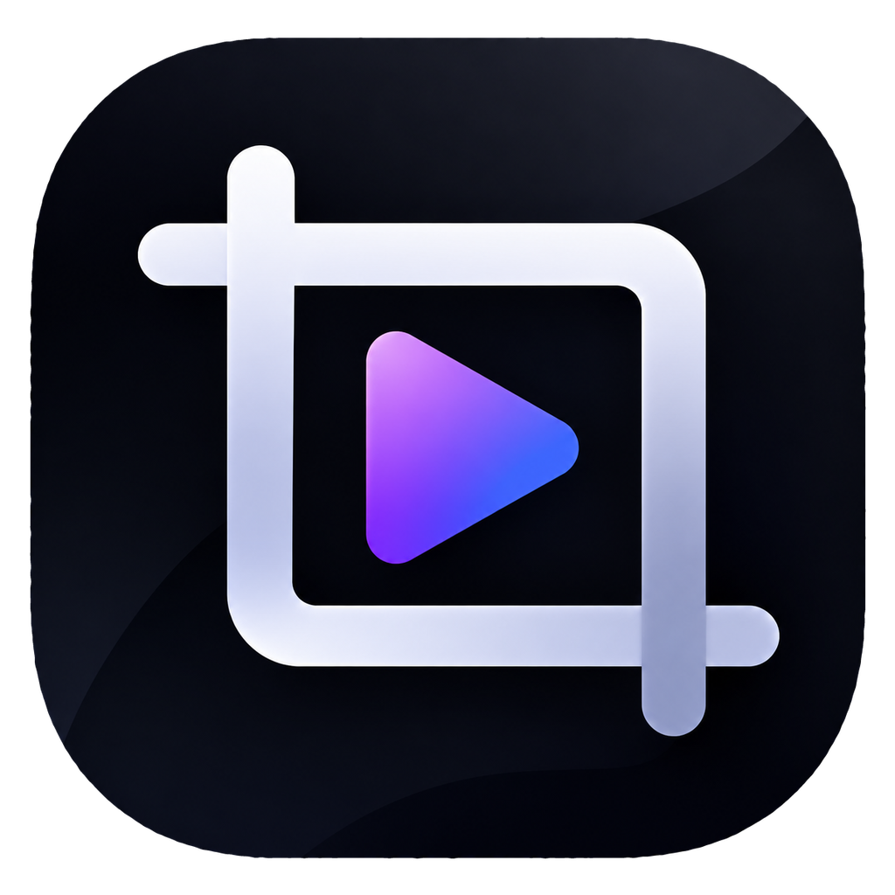
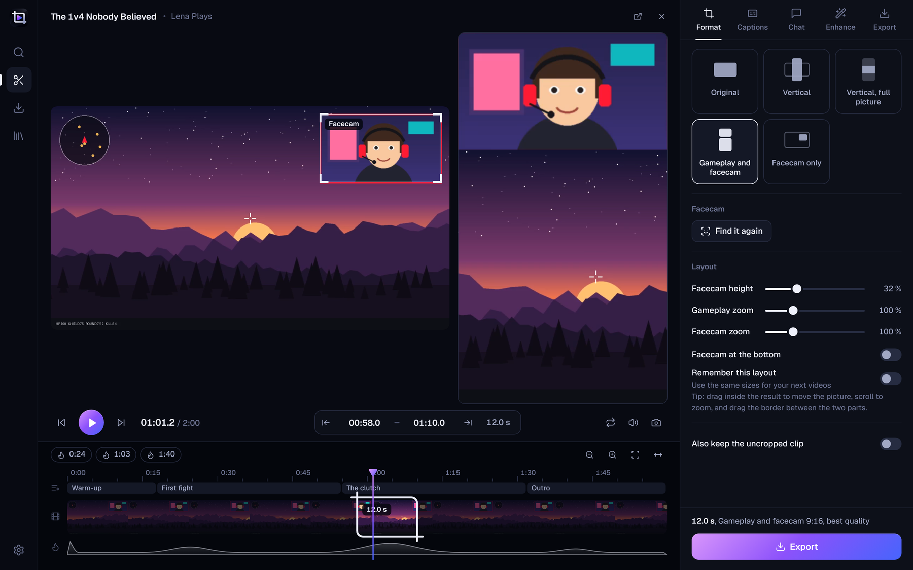
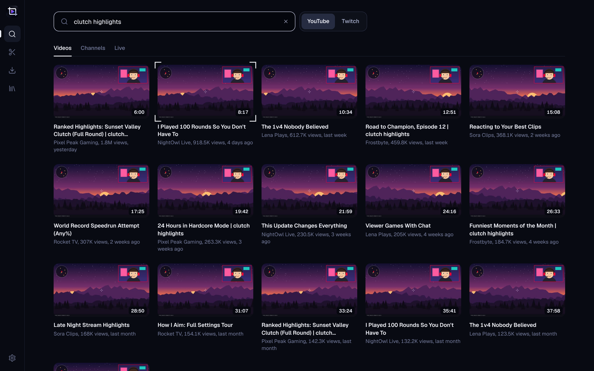
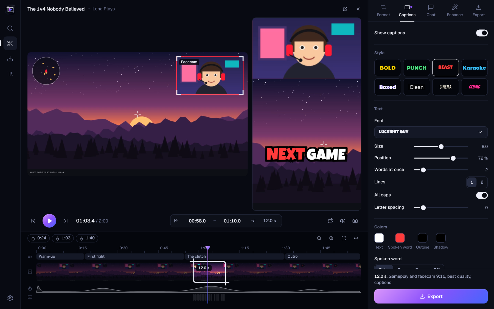

  

<h1 align="center">Snipload</h1>

  <b>Find a video on YouTube or Twitch, cut the part you want, and get a finished clip.</b> 
  With a live preview, vertical formats, animated captions, the chat, and one click into your editing program.

  <a href="../../releases/latest"><b>⬇ Download Snipload.exe</b></a> ·
  Windows 10 / 11 · free · no installation ·
  <a href="README.de.md">Deutsch</a>

  

---

## Why Snipload?

Downloading a whole 3-hour stream to keep 30 seconds of it is slow and wastes space. Snipload asks YouTube or
Twitch only for the part you choose, cuts it exactly, and can turn it into a ready-to-post Short in the same
step. No account, no ads, no browser extension.

## What it does

### Find
- **Paste a link** (or press `Ctrl+V` anywhere in the app) and the video opens in the editor.
- **Search YouTube** for videos, channels and live streams.
- **Open Twitch channels**: past broadcasts, highlights, uploads and the top clips of the week, month or all
  time. If the streamer is live, you can clip the running stream from its recording.
- **Save channels** you clip from often. Recently opened videos are one click away.

### Cut
- **Watch the video in the editor** and set the start and end with the mouse, the time fields or `I` and `O`.
- **Timeline** with preview pictures, chapters and YouTube's "most replayed" curve. Scroll to zoom.
- **Best moments from the chat**: Snipload reads the chat of a stream and marks where it was busiest.
- **Several clips at once**: add parts to a list and export them all with the same settings.
- **Frame-accurate cuts**, or faster cuts if you don't need that.

### Formats
| Format | What you get |
|---|---|
| **Original** | The video as it is, up to 4K |
| **Vertical** | 9:16, cropped. Drag the crop where you want it |
| **Vertical, full picture** | 9:16 with the whole picture and a blurred background |
| **Gameplay and facecam** | 9:16 with the facecam on top and the gameplay below |
| **Facecam only** | Just the camera as its own video |
| **Sound only** | MP3, M4A or WAV |
| **GIF** | For chats and forums |

The result is shown live next to the source video while it plays. For the facecam formats, Snipload finds
the camera on its own; you can move the frame, zoom both parts and drag the border between them.

### Captions

- **AI transcription** for any video (runs on your PC with whisper.cpp, nothing is uploaded), or the
  subtitles YouTube already has.
- **Word-by-word animation** with eight styles to start from.
- **Any font**: the ones that come with Snipload, every font installed on your PC, or your own font file.
- Size, position, colors, outline, shadow, box, highlight of the spoken word. Fix words directly in the list.
- Burned into the video, as a separate `.srt` file, or both.

### Chat
- **Download the chat** of a Twitch VOD or a YouTube stream for your clip, with badges and emotes
  (including 7TV, BetterTTV and FrankerFaceZ).
- **Show it in the video**, or **save it as its own transparent video** (MOV with alpha, WebM, or green
  screen) to place it yourself in your editing program.

### Enhance
- Speed, brightness, contrast, color, sharpening, volume, loudness normalization, fades.
- **Upscale** to 1080p, 1440p or 4K: fast, with AI (Real-ESRGAN, downloaded on demand), or with
  Topaz Video AI if you have it installed.
- Keep a file under a size limit, for example 10 MB for Discord.

### Send it to your editing program
- **Premiere Pro**: the clip appears in your open project by itself, in a bin, at the playhead or as a new
  sequence. Snipload installs a small extension for this; Premiere needs one restart the first time.
- **After Effects**: the clip is imported and opened as a composition.
- **CapCut, DaVinci Resolve, VEGAS** and any program you add: Snipload opens it and puts the clip in the
  clipboard, ready to paste.

### And the rest
- **10 languages**: English · Deutsch · 日本語 · Español · Français · Português · 한국어 · 简体中文 · Türkçe · Русский
- **Works out of the box**: Snipload downloads [yt-dlp](https://github.com/yt-dlp/yt-dlp) and
  [ffmpeg](https://ffmpeg.org) by itself and keeps yt-dlp up to date.
- **Updates itself** in the background.
- **Library** of everything you exported, with search and playback.

## Getting started

1. **[Download `Snipload.exe`](../../releases/latest)** (under *Assets*) and run it. There's nothing to install.
2. If Windows shows *“Windows protected your PC”*, click **More info → Run anyway**. This happens with
   new apps that aren't code-signed.
3. On first use, Snipload offers to download yt-dlp and ffmpeg. Click **Download now** and wait about a minute.
4. Paste a link or search, pick your part, press **Export**.

**Shortcuts:** `Space` play · `I` / `O` start and end · `Q` / `W` jump to start and end · `A` add clip to
the list · `Ctrl+Enter` export · `Ctrl+K` search · `?` shows all of them

## FAQ

<b>The video doesn't play in the editor</b>

YouTube videos play through YouTube's own player. A few videos don't allow that (some music videos, for
example). Snipload then plays the video directly, and if that isn't possible either, it shows still frames.
Cutting and exporting work in every case.

<b>The export is slow</b>

Frame-accurate cutting, vertical formats, captions and effects all mean the video is rendered again.
Snipload uses your graphics card when it can. For plain clips you can turn off **Cut exactly to the frame**
on the Export tab, which is many times faster, though the clip may then start a moment early. AI upscaling
is slow by nature.

<b>“YouTube refused the download (HTTP 403)”</b>

YouTube changes things often, and older yt-dlp versions stop working. Snipload updates yt-dlp and retries
automatically. If it still happens, wait a few minutes and try again.

<b>Where are my files?</b>

By default in your **Downloads** folder. You can change it in the settings or on the Export tab. File names
follow a template with `{title}`, `{channel}`, `{start}`, `{end}`, `{date}` and `{id}`.

<b>Is it safe?</b>

The source code is right here. Every release is built automatically by GitHub Actions from this code (see
*Actions*). Snipload talks to YouTube and Twitch, to GitHub (updates and tools), to the official ffmpeg
build server, to Hugging Face (the speech model, only if you use AI captions) and to the emote services
7TV, BetterTTV and FrankerFaceZ (only if you load a Twitch chat).

> Please only download content you're allowed to use.

## For developers

Snipload is written in Python. The interface is a web page (plain HTML, CSS and JavaScript, no framework)
shown in a native window through [pywebview](https://pywebview.flowrl.com) and Edge WebView2, and talks to
the Python side over a local server. It is packaged with PyInstaller.

| Path | Contents |
|---|---|
| `src/main.py` | Entry point (plus `--selftest` and `--nettest` for CI) |
| `src/snipload/webapp.py` · `server.py` · `backend.py` | Window, local server, everything the interface can call |
| `src/snipload/web/` | The interface: `js/editor.js`, `js/inspector.js`, `js/timeline.js`, `js/preview.js`, … |
| `src/snipload/jobs.py` · `finish.py` | Downloads, queue, cutting, rendering (yt-dlp + ffmpeg) |
| `src/snipload/search.py` | YouTube and Twitch search, channels, VOD details |
| `src/snipload/captions.py` | Subtitles from YouTube or whisper.cpp, fonts, animated ASS captions |
| `src/snipload/chat.py` | Chat download (Twitch, YouTube) and rendering |
| `src/snipload/facecam.py` | Facecam detection and the 9:16 layout |
| `src/snipload/upscale.py` | Real-ESRGAN and Topaz Video AI |
| `src/snipload/editors.py` | Premiere Pro, After Effects and other editing programs |
| `src/snipload/tools.py` · `updater.py` | yt-dlp and ffmpeg, self-update |
| `src/snipload/i18n.py` · `locales/` | Translations (English source texts in `locales/_keys.py`) |
| `.github/workflows/build.yml` | Builds the exe on Windows, tests it, publishes the release |

To try the interface in a browser while developing: `python -m snipload.webapp --dev` (from `src/`) prints
a local address. The version number lives in `src/snipload/__init__.py`; the build number is appended
automatically.

Third-party licenses are listed in the app under **Settings → Licenses**.
